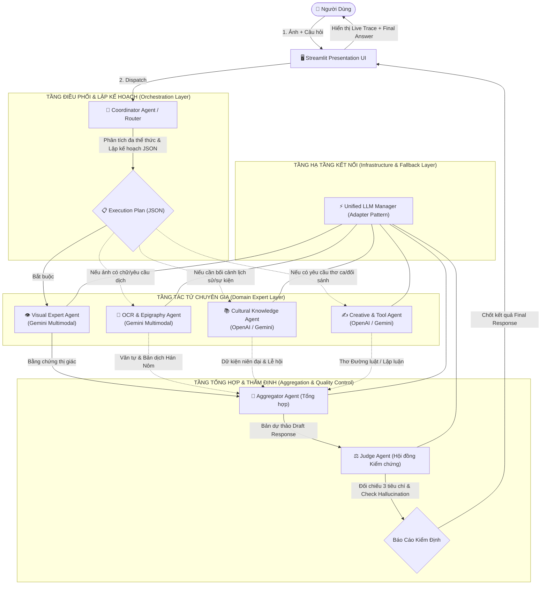

# TÀI LIỆU KIẾN TRÚC HỆ THỐNG MULTI-AGENT VQA
## CHUYÊN BIỆT CHO DI TÍCH LỊCH SỬ & VĂN HÓA NGHỆ THUẬT VIỆT NAM

---

## I. TỔNG QUAN TRIẾT LÝ THIẾT KẾ (DESIGN PHILOSOPHY)

Hỏi-Đáp Thị Giác (Visual Question Answering - VQA) trong lĩnh vực văn hóa và di tích lịch sử đòi hỏi sự giao thoa phức tạp giữa:
1. **Thị giác máy tính đa thể thức (Multimodal Vision):** Nhận diện đường nét kiến trúc, chất liệu cổ truyền, chi tiết điêu khắc và hoa văn thời Lý, Trần, Lê, Nguyễn.
2. **Khai phá văn tự cổ (Epigraphy & OCR):** Đọc, phiên âm Hán-Việt và dịch nghĩa hoành phi, câu đối, văn bia đá.
3. **Tri thức lịch sử hàn lâm (Domain Historical Knowledge):** Niên đại khởi dựng, biến cố triều đại, sự tích dân gian và các lễ hội văn hóa định kỳ.
4. **Kiểm soát tính chân thực (Hallucination Control):** Tránh hiện tượng mô hình AI "bịa đặt" các chi tiết không có trong ảnh hoặc xuyên tạc lịch sử.

Để giải quyết bài toán trên, hệ thống không sử dụng mô hình đơn lẻ (Monolithic / Single-Prompt) mà được xây dựng theo kiến trúc **Heterogeneous Multi-Agent** (Đa Tác tử Không đồng nhất) kết hợp cơ chế **Dynamic Routing (Định tuyến động)** và **Self-Refining Verification (Tự thẩm định và hiệu chỉnh)**.

---

## II. SƠ ĐỒ KIẾN TRÚC TỔNG THỂ (SYSTEM ARCHITECTURE)

---

## III. CHI TIẾT CÁC TẦNG TRONG HỆ THỐNG

### 1. Tầng Điều Phối & Lập Kế Hoạch (Coordinator Agent / Planner & Router)
- **Vị trí:** [`agents/coordinator.py`](file:///c:/Users/nv770/OneDrive/Desktop/demo_new/agents/coordinator.py)
- **Nhiệm vụ:**
  - Nhận [Ảnh + Câu hỏi] của người dùng.
  - Phân tích ngữ nghĩa câu hỏi và quét thị giác sơ bộ bức ảnh để phân loại tác vụ vào 5 nhóm:
    - `QA_Fact`: Câu hỏi dữ kiện địa danh, sự tích, nhân vật.
    - `Visual_Description`: Phân tích hình thái kiến trúc, màu sắc, bố cục mỹ thuật.
    - `OCR_Translation`: Đọc chữ Hán Nôm, văn bia, hoành phi, biển hiệu.
    - `Creative`: Yêu cầu sáng tác văn học, thơ ca cổ phong, cảm tác.
    - `Knowledge_Search`: Đào sâu tri thức triều đại, lễ hội và sự kiện văn hóa.
- **Cơ chế Tiết kiệm & Tối ưu (Zero-Waste Execution):**
  - Coordinator xuất ra **JSON Execution Plan**.
  - Ví dụ: Nếu người dùng hỏi *"Chùa Một Cột được xây năm nào?"*, Coordinator nhận diện ảnh không cần dịch chữ nên **không kích hoạt OCR Agent**, chỉ gọi `visual_agent` và `knowledge_agent`. Nhờ đó tiết kiệm tài nguyên API và giảm 50% thời gian phản hồi.

---

### 2. Tầng Tác Tử Chuyên Gia (Domain Expert Layer)
- **Vị trí:** [`agents/experts.py`](file:///c:/Users/nv770/OneDrive/Desktop/demo_new/agents/experts.py)

#### A. Visual Expert Agent (Gemini Multimodal Vision)
- **Vai trò:** "Đôi mắt của hệ thống".
- **Nhiệm vụ:** Giám định các đặc trưng vật lý của di tích/cổ vật trong ảnh:
  - Hệ thống mái (mái đao cong vút, ngói mũi hài, ngói âm dương).
  - Chi tiết trang trí bờ nóc, bờ dải (kìm nóc, rồng chầu mặt nguyệt, phượng vũ).
  - Kết cấu bộ khung chịu lực (cột gỗ lim, hệ vì kèo, xà ngang, chân tảng đá).
  - Trích xuất các **Bằng chứng thị giác (Visual Evidences)** làm cơ sở đối chiếu cho các Agent khác.

#### B. OCR & Epigraphy Agent (Gemini Multimodal - Hán Nôm Specialist)
- **Vai trò:** "Chuyên gia Văn tự & Văn bia Cổ".
- **Nhiệm vụ:**
  - Định vị tọa độ các bức hoành phi, biển gỗ, đôi câu đối trên cột hoặc bia ký bằng đá.
  - Trích xuất chữ gốc, phiên âm Hán - Việt chuẩn mực (ví dụ: *Quốc Thái Dân An*, *Vạn Cổ Trường Tồn*).
  - Dịch nghĩa tiếng Việt hiện đại và giải mã tầng sâu triết lý Nho giáo/Phật giáo/Đạo giáo ẩn sau câu đối.

#### C. Cultural Knowledge Agent (OpenAI / Gemini Tri Thức Sâu)
- **Vai trò:** "Nhà Nghiên cứu Lịch sử & Di sản".
- **Nhiệm vụ:** Kết nối di tích nhận dạng được với kho tàng tri thức lịch sử Việt Nam:
  - Khởi dựng năm nào? Dưới thời vua nào (Lý Thái Tông, Lê Thánh Tông...)?
  - Ý nghĩa phong thủy, kiến trúc và giá trị di sản (Di tích Quốc gia đặc biệt, UNESCO).
  - Các sự kiện, lễ hội văn hóa định kỳ (ví dụ: Hội Gióng, Lễ hội Đền Hùng, Hội Chùa Hương).

#### D. Tool / Generation Agent (Creative & Analytical Reasoning)
- **Vai trò:** "Tác tử Sáng tạo Văn Nghệ & Biện luận".
- **Nhiệm vụ:**
  - Thực thi các yêu cầu sáng tạo cao cấp: Làm thơ thất ngôn bát cú Đường luật, thơ lục bát đúng luật bằng trắc, mang âm hưởng hào hùng hoặc trầm mặc của di tích.
  - So sánh đối chiếu mỹ thuật giữa các thời kỳ lịch sử.

---

### 3. Tầng Tổng Hợp & Thẩm Định Chất Lượng (Aggregation & Verification Layer)
- **Vị trí:** [`agents/aggregator_judge.py`](file:///c:/Users/nv770/OneDrive/Desktop/demo_new/agents/aggregator_judge.py)

#### A. Aggregator Agent
- Nhận kết quả độc lập từ các Expert Agents đã kích hoạt.
- Đúc kết thành một **Bản dự thảo hoàn chỉnh (Draft Response)** gồm cấu trúc 3 phần chuẩn mực:
  1. *Câu trả lời trực diện vào câu hỏi.*
  2. *Bằng chứng thị giác từ bức ảnh.*
  3. *Góc mở rộng lịch sử, văn hóa & lễ hội liên quan.*

#### B. Judge Agent (Hội đồng Thẩm tra & Kiểm soát Hallucination)
- Hoạt động độc lập như một "Quan tòa" đánh giá bản dự thảo dựa trên 3 tiêu chí khắt khe:
  1. **Visual Fidelity (Độ trung thực thị giác):** Đối chiếu xem bản nháp có bịa đặt chi tiết nào không có trong ảnh gốc từ Visual/OCR Agent không? (Chống Ảo giác / Hallucination).
  2. **Relevance (Tính trúng đích):** Đã giải quyết triệt để câu hỏi cốt lõi của người dùng chưa?
  3. **Cultural Tone (Văn phong Di sản):** Ngôn từ có chuẩn mực, trang trọng và phù hợp với tính chất tôn nghiêm của di tích không?
- **Khả năng Tự sửa lỗi (Self-Correction):** Nếu phát hiện chi tiết chưa chính xác, Judge Agent tự động chỉnh sửa trực tiếp và xuất ra bản **Final Response** hoàn mỹ nhất.

---

### 4. Tầng Hạ Tầng Kết Nối & Fallback Đa API (Infrastructure Layer)
- **Vị trí:** [`utils/llm_clients.py`](file:///c:/Users/nv770/OneDrive/Desktop/demo_new/utils/llm_clients.py)
- Triển khai theo mô hình **Adapter Pattern (Bộ điều hợp)**:
  - Đóng gói toàn bộ lệnh gọi API của Google Gemini (`google-genai`) và OpenAI (`openai`).
  - Hỗ trợ truyền ảnh Multimodal (PIL Image cho Gemini, Base64 Image URL cho OpenAI).
  - Trích xuất JSON schema an toàn với cơ chế Regex tự làm sạch markdown blocks.
  - **Cơ chế Fallback thông minh:**
    - Nếu hệ thống có cả 2 key -> Phân bổ mô hình theo đúng sở trường Heterogeneous.
    - Nếu chỉ có 1 key (chỉ có Gemini hoặc chỉ có OpenAI) -> Tự động chuyển toàn bộ hệ thống sang key có sẵn để phiên demo không bao giờ bị đứt đoạn.

---

## IV. BẢNG SO SÁNH: MULTI-AGENT VQA vs. SINGLE-PROMPT VQA

| Tiêu chí | Single-Prompt VQA Truyền thống | Hệ Thống Multi-Agent VQA của Chúng Ta |
| :--- | :--- | :--- |
| **Kiến trúc** | 1 Prompt gửi toàn bộ ảnh + câu hỏi cho 1 LLM duy nhất | Hệ thống Đa Tác tử điều phối chuyên môn hóa từng khâu |
| **Xử lý Chữ cổ / Hoành phi** | Dễ dịch sót, nhầm lẫn chữ Hán Nôm do phân tán chú ý | Có **OCR & Epigraphy Agent** chuyên trách đọc và giải mã |
| **Kiểm soát Hallucination** | Không có cơ chế kiểm chứng; mô hình dễ bịa đặt thông tin | Có **Judge Agent** độc lập thẩm định 3 tiêu chí và rà soát lỗi |
| **Tính linh hoạt & Tối ưu** | Luôn phải chạy mô hình nặng cho mọi câu hỏi | **Coordinator** chỉ kích hoạt các agent cần thiết (Zero-waste) |
| **Khả năng quan sát tiến trình** | Người dùng chỉ thấy màn hình chờ và kết quả cuối | **Live Agent Trace** hiển thị từng bước suy luận thời gian thực |
| **Tính mở rộng (Extensibility)** | Khó tích hợp thêm công cụ mới | Dễ dàng cắm thêm Search Tool, Agent mới hoặc Claude/DeepSeek |

---

## V. LUỒNG THỰC THI THỜI GIAN THỰC (EXECUTION TRACE EXAMPLE)

Khi người dùng gửi ảnh **Chùa Một Cột** với câu hỏi: *"Đây là di tích nào? Kiến trúc đài sen nghìn năm này gắn với truyền thuyết gì?"*

1. **Terminal / Console log:**
   - `[COORDINATOR]` nhận diện task: `QA_Fact`, `Visual_Description`, `Knowledge_Search`.
   - `[COORDINATOR]` quyết định: kích hoạt `visual_agent` và `knowledge_agent`, bỏ qua `ocr_agent` và `tool_gen_agent`.
2. **Visual Agent:**
   - Phân tích hình thái: Độc trụ đá đường kính 1.2m nâng đỡ đài hoa sen gỗ sơn nâu trầm, mái ngói vút cong hình đao, nằm giữa hồ sen vuông vắn (Hồ Linh Chiểu).
3. **Knowledge Agent:**
   - Truy xuất sử liệu: Chùa Diên Hựu, dựng năm Kỷ Sửu (1049) thời vua Lý Thái Tông, bắt nguồn từ giấc mơ thấy Phật Bà Quan Âm ngồi trên tòa sen dắt vua lên đài.
4. **Aggregator Agent:**
   - Hợp nhất dữ liệu thành 3 mục: Câu trả lời định danh + Bằng chứng kiến trúc + Điển tích giấc mơ thời Lý.
5. **Judge Agent:**
   - Chấm điểm: Visual Fidelity (9.8/10 PASS), Relevance (10/10 PASS), Cultural Tone (9.8/10 PASS).
   - Xác nhận: Không phát hiện lỗi bịa đặt chi tiết thị giác.
   - Xuất bản Final Response ra giao diện Web Streamlit.
