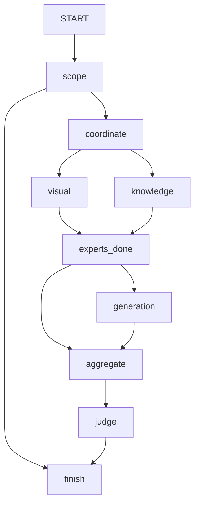

# Kiến trúc đang triển khai

Phiên bản 0.2: một LangGraph dùng chung cho Streamlit, CLI, comparison và API worker.

Đồ thị thực có các cạnh điều kiện và được xuất tự động tại [docs/langgraph.mmd](docs/langgraph.mmd). Các cạnh visual/knowledge là fan-out song song, expert results và lỗi dùng reducer. Generation chạy sau barrier; aggregator chạy một lần sau các nhánh đã chọn.

## Các module

- `core/config.py`: YAML, env overrides tường minh, schema/capability declarations và public config snapshot.
- `core/schemas.py`: hợp đồng ExecutionPlan, SourceRecord, JudgeOutput, RunResult, RunEvent.
- `core/gateway.py`: provider clients, credential snapshot, attempt budget, timeout/retry/fallback và usage metadata.
- `core/search.py`: Wikipedia adapter với trạng thái tìm kiếm và nguồn có ID; navigation tách riêng.
- `core/images.py`: kiểm tra ảnh, chuẩn hóa hướng/RGB, bỏ metadata và tạo fingerprint.
- `agents/`: chuyên môn và prompts; Judge kiểm tra ảnh cùng đoạn nguồn đã thực sự nhận.
- `workflow/service.py`: graph, state, chuyển trạng thái lỗi và service chạy/stream node events.
- `workflow/comparison.py`: chạy cùng service cho Proposed, giữ baseline errors và không tự chấm accuracy.
- `ui_app.py`, `app.py`, `benchmark_run.py`: presentation/CLI adapters.
- `tests/`: transport fixtures, regression, graph concurrency/checkpoint và UI AppTest.
- `api/`: FastAPI, sessions/ownership, assets, durable run queue, SSE và worker.
- `migrations/`: schema/versioning SQLite local và PostgreSQL server.
- `core/observability.py`, `core/runtime_logging.py`: LangSmith content policy và JSON logs.
- `postman/`, `deploy/`, `monitoring/`: API client mẫu và cấu hình vận hành.

State không chứa API clients/keys. Ảnh trong state ở dạng bytes để checkpointer có thể serialize. Result xuất ra không chứa ảnh gốc hoặc credentials.

Mỗi run có manager/budget riêng và đóng clients sau khi kết thúc. UI theo dõi input hash gồm ảnh, câu hỏi, audience, mode và config, không trình bày result cũ dưới input mới. Stream công khai là các node events; bản nháp được giữ riêng đến bước kiểm tra.

## Giới hạn có chủ ý của đợt đầu

Judge hiện đánh giá toàn đáp án dựa trên schema, ảnh và snippets; chưa phải claim-evidence engine đầy đủ. Nguồn có ID và URL đúng registry chưa bảo đảm nội dung được nguồn hỗ trợ. Không dùng điểm tự đánh giá làm ground truth nghiên cứu.

API lưu queue, run/events, model attempts và feedback trong DB; worker claim job,
heartbeat/lease và hỗ trợ cancel/retry. Checkpointer LangGraph injectable, mặc
định không bật; InMemorySaver được test nhưng không bền qua restart. Chưa có
resume node từ checkpoint sau crash, corpus RAG, tool registry, debate hoặc GPU
đã đo. [API và triển khai](docs/api-server.md) · [Giám sát](docs/observability.md).

Tham khảo cơ chế graph, state, reducers và conditional edges trong [LangGraph Graph API](https://docs.langchain.com/oss/python/langgraph/graph-api); lưu trạng thái trong [LangGraph persistence](https://docs.langchain.com/oss/python/langgraph/persistence).
