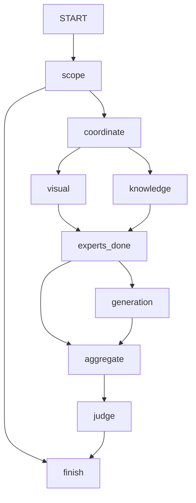

# Kiến trúc đang triển khai

Một LangGraph dùng chung cho Streamlit, CLI, comparison và API worker. Bản API
hiện tại có Swagger `1.2.0`, 81 operations, Postman 84 requests và migration
head `0009_runtime_state`; tiền tố HTTP vẫn là `/api/v1`.

Profile chọn dùng `config/hanoi-evidence.yaml` bổ sung slot/candidate, quan sát ảnh/OCR,
evidence registry, Verifier theo claim và ghép phần có căn cứ. `workflow/accuracy.py`
giữ logic dùng chung, `core/evidence.py` giữ hợp đồng/gate, `core/tools.py` thực thi tool
có budget/cache/trace, `core/ingestion.py` nhập nguồn giới hạn allowlist. Parent/child
continuation lưu riêng `input_context` và result, không sửa kết quả gốc. Chi tiết flow,
API, cấu hình, đánh giá và rollback: [accuracy profile](docs/accuracy-profile.md).

Nhận diện ảnh có hợp đồng riêng `recognition`: visual liên kết ứng viên với quan sát,
Verifier đánh giá mức nhận diện, `core/recognition.py` kiểm tra cơ sở/ID/thực thể.
`probable` được trả lời có điều kiện, độc lập với kiểm chứng lịch sử và `answer_status`.
Gợi ý địa điểm có nguồn gốc rõ và không đi vào quan sát ảnh độc lập. Nhãn sample không
được coi là gold; evaluation mặc định nhận diện không dùng nhãn.
Kế hoạch sửa luồng: [recognition plan](docs/recognition-plan.md).

`core/entities.py` chuẩn hóa alias và qualifier có kiểm tra địa phương/parent, giữ tách
site/component. Retrieval tìm trang bằng tên ngắn, lấy toàn bài Wikipedia từng trang,
chọn đoạn theo câu hỏi và lọc entity trước khi gọi Knowledge. Gate thêm `risk_tags` cho
phiên đọc Hán–Nôm, vật liệu cụ thể và niên đại; các thuộc tính cần nguồn không được bỏ
qua chỉ bằng cách gắn kind=visual. Giới hạn output và báo cáo trung gian nằm trong YAML.

Đồ thị thực có các cạnh điều kiện và được xuất tự động tại [docs/langgraph.mmd](docs/langgraph.mmd). Các cạnh visual/knowledge là fan-out song song, expert results và lỗi dùng reducer. Generation chạy sau barrier; aggregator chạy một lần sau các nhánh đã chọn.

## Các module

- `core/config.py`: YAML, env overrides tường minh, schema/capability declarations và public config snapshot.
- `core/schemas.py`: hợp đồng ExecutionPlan, SourceRecord, JudgeOutput, RunResult, RunEvent.
- `core/gateway.py`: provider clients, credential snapshot, attempt budget, timeout/retry/fallback và usage metadata.
- `core/preflight.py`: probe metadata theo role, timeout, cache HMAC theo credential/model và gộp request trùng; không gọi generation.
- `core/search.py`: Wikipedia adapter với trạng thái tìm kiếm và nguồn có ID; navigation tách riêng.
- `api/content_store.py`: nguồn DB có phiên bản/reviewer/hash, publication transaction, entity binding và adapter retrieval chỉ đọc nguồn được duyệt/công bố.
- `core/retrieval_cache.py`: cache artifact retrieval công khai dùng chung giữa tiến trình, có TTL/giới hạn và khóa theo policy/source revision; không cache đáp án model hoặc credential.
- `core/images.py`: kiểm tra ảnh, chuẩn hóa hướng/RGB, bỏ metadata và tạo fingerprint.
- `agents/`: chuyên môn và prompts; Judge kiểm tra ảnh cùng đoạn nguồn đã thực sự nhận.
- `workflow/service.py`: graph, state, chuyển trạng thái lỗi và service chạy/stream node events.
- `workflow/comparison.py`: chạy cùng service cho Proposed, giữ baseline errors và không tự chấm accuracy.
- `ui_app.py`, `app.py`, `benchmark_run.py`: presentation/CLI adapters.
- `tests/`: transport fixtures, regression, graph concurrency/checkpoint và UI AppTest.
- `api/`: FastAPI, sessions/ownership, assets, durable run queue, SSE và worker.
- `api/accounts.py`, `api/conversations.py`: tài khoản/password hash, token rotation/RBAC, stable owner, hội thoại/turn/message/memory và yêu thích di tích.
- `api/recovery.py`, `api/lifecycle.py`: checkpoint node đã hoàn tất, recovery có giới hạn, soft-delete run và retention/purge có bước plan trước apply.
- `migrations/`: schema/versioning SQLite local và PostgreSQL server.
- `core/observability.py`, `core/runtime_logging.py`: LangSmith content policy và JSON logs.
- `postman/`, `deploy/`, `monitoring/`: API client mẫu và cấu hình vận hành.

State không chứa API clients/keys. Ảnh trong state ở dạng bytes để checkpointer có thể serialize. Result xuất ra không chứa ảnh gốc hoặc credentials.

Mỗi run có manager/budget riêng và đóng clients sau khi kết thúc. UI theo dõi input hash gồm ảnh, câu hỏi, audience, mode và config, không trình bày result cũ dưới input mới. Stream công khai là các node events; bản nháp được giữ riêng đến bước kiểm tra.

## Ownership, dữ liệu và vòng đời

Session khách tiếp tục hoạt động độc lập. Tài khoản có owner ổn định để chia sẻ
run/asset giữa các lần đăng nhập; access/refresh token từng phiên được băm,
refresh xoay token và logout thu hồi phiên hiện tại. Đăng ký chỉ cấp role user;
editor/admin được kiểm tra lại trong DB. Gán role cần admin đã xác thực hoặc
operations bearer của server. Bootstrap/operations token không vào browser.

Hội thoại và message tách khỏi quan hệ parent của retry/review/clarification.
Memory mặc định tắt, có giới hạn 8 message/4000 ký tự, chỉ lưu ngữ cảnh có
provenance; đáp án cũ và lời người dùng không trở thành tư liệu đã xác minh.
Yêu thích di tích tách khỏi bookmark run. Xóa hội thoại không tự xóa run của nó.

Catalog giữ metadata, ảnh và tọa độ. Entity binding nối ID DB với nhãn canonical
và quan hệ quần thể/thành phần; selection được truyền thành hint chưa xác minh.
Nguồn biên tập có text/hash/version bất biến qua API, reviewer và publication
được kiểm tra đồng thời trong transaction. Draft hoặc phiên bản rút khỏi công
bố không đi vào retrieval. Metadata nguồn cũ vẫn có `not_indexed`; không tự
chuyển chúng thành evidence. REST media dùng vùng upload writable riêng, giữ
các ảnh do người vận hành cấp trong `API_CATALOG_MEDIA_DIR` bất biến. Thư mục
mặc định là `catalog-media/`, không phụ thuộc cây frontend. Audit lưu actor và
thay đổi catalog/source/media.

Run có soft-delete; retention bảo vệ account owner, active jobs và quan hệ còn
tham chiếu. Công cụ purge mặc định chỉ plan, apply là thao tác vận hành riêng.
Backup bao gồm cả DB và assets, cần kiểm tra restore vào môi trường riêng.

## Kiểm chứng và phục hồi

Preflight chạy trước graph với bốn role bắt buộc; các role tùy chọn kiểm tra khi
plan chọn. Probe metadata không chứng minh quota sinh nội dung. Lỗi Judge có mã
và nhóm configuration/technical/review_format/evidence, luôn giữ trạng thái chưa
kiểm chứng khi đánh giá thất bại.

Review-only dùng graph entry ở `judge`, tạo run con `run_kind=review` trong DB,
giữ liên kết `parent_run_id` và `upstream_config_hash`. Worker đọc snapshot kết
quả gốc, kiểm tra fingerprint ảnh, dùng lại plan/experts/draft. Các stage dùng lại
vẫn phát event để frontend quan sát, được gắn `reused=true`; attempts/usage chỉ
ghi nhận lần đánh giá mới. Run gốc bất biến. Luồng này phục hồi từ artifact đã
lưu. Đây là run con đánh giá lại Judge, khác cơ chế replay node của run bị mất
worker. Xem [hợp đồng API](docs/api-server.md).

Ở profile mặc định, Judge đánh giá toàn đáp án dựa trên schema, ảnh và snippets.
Profile evidence-v2 thêm registry bằng chứng và kiểm tra từng nhận định, entity,
trích đoạn và thuộc tính cần nguồn. ID/quotation hợp lệ không tự chứng minh suy
luận lịch sử đúng; phần kiểm tra ngữ nghĩa vẫn phụ thuộc model. Không dùng điểm
tự đánh giá làm ground truth nghiên cứu. Bộ pilot vẫn là dữ liệu draft; cần
nguồn biên tập và bộ gold do người duyệt trước khi công bố chất lượng tổng thể.

API lưu queue, events, attempts và feedback trong DB; worker claim atomic và
heartbeat/lease. Khi bật durable recovery, completed-node updates được lưu
trong DB. Mất lease có thể requeue có giới hạn; `/runs/{id}/recovery` và POST
`resume` cung cấp trạng thái/khôi phục WorkerLost đủ điều kiện. Replay yêu cầu
owner còn hợp lệ, lease hiện tại, input/build/config/source signature khớp và
ngân sách còn lại. Node đang dở hoặc external call bị ngắt có thể phải chạy lại.
Đây chưa phải snapshot tùy ý giữa node/token, cũng không đảm bảo exactly-once
cho lời gọi provider bị mất kết nối. LangGraph checkpointer vẫn injectable,
mặc định không thay thế bằng một arbitrary durable LangGraph saver.

Profile evidence có tool registry/trace, Wikipedia, JSONL và nguồn DB được
duyệt. Cache chỉ tái sử dụng artifact retrieval công khai, có revision invalidation;
không biến hint chưa xác minh hoặc đáp án model thành tư liệu. Chưa có embedding/vector index,
corpus/gold chuẩn đã nghiệm thu, debate hoặc số đo GPU để công bố.
[API và triển khai](docs/api-server.md) · [Giám sát](docs/observability.md).

Tham khảo cơ chế graph, state, reducers và conditional edges trong [LangGraph Graph API](https://docs.langchain.com/oss/python/langgraph/graph-api); lưu trạng thái trong [LangGraph persistence](https://docs.langchain.com/oss/python/langgraph/persistence).
