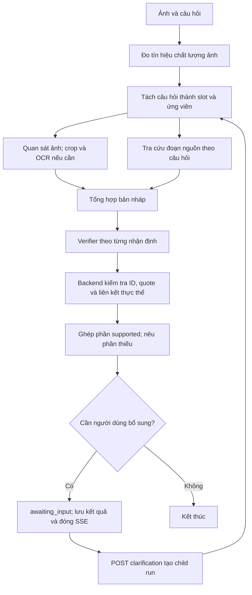

# Profile bằng chứng và trải nghiệm hỏi đáp

Nếu vừa cập nhật code/schema mà Streamlit báo `ValidationError` dù YAML hợp lệ,
dừng rồi chạy lại tiến trình Streamlit để nạp các model cấu hình mới. Refresh/Rerun
trong phiên trình duyệt có thể vẫn dùng module Python cũ. UI báo tên trường và loại
lỗi cấu hình, không in giá trị input, thông báo validator thô hoặc credential.

Nhánh `feat/evidence-accuracy-ux` triển khai một profile chọn dùng, tập trung pilot Hà Nội.
API, worker và Streamlit dùng cùng `RunService`. Profile mặc định vẫn đọc/chạy được;
result cũ thiếu trường mới được đọc với `result_schema_version=1` và danh sách bằng chứng rỗng.
Profile mới trả version 2, không đổi tiền tố `/api/v1`.

## Chạy và thử

Từ thư mục `doan_demo`, mở terminal riêng. Demo dùng SQLite/media ở `.api-demo/interactive`,
không dùng database production, không gọi model hay truy xuất Internet. Nếu terminal có
`DATABASE_URL` PostgreSQL/MySQL, launcher demo sẽ từ chối; bỏ biến đó trong terminal demo.

```powershell
uv sync --locked --group dev
uv run --locked python -m scripts.serve_api --demo --profile hanoi-evidence --port 8001
```

Mở <http://127.0.0.1:8001/docs>. Gọi theo thứ tự:

1. `POST /api/v1/sessions` → lấy `access_token`; nhập ở Authorize / HTTPBearer.
2. `GET /api/v1/samples` → chọn `sample_id`.
3. `POST /api/v1/samples/{sample_id}/assets` → lấy `asset_id`.
4. `POST /api/v1/runs`, header `Idempotency-Key` duy nhất, body ví dụ bên dưới.
5. `GET /api/v1/runs/{run_id}` hoặc `/events` để theo dõi. `/events/history` trả JSON;
   SSE phát stage running/completed/failed, có `id` và kết nối lại bằng `Last-Event-ID`.
6. `/result`, `/evidence`, `/sources`, `/steps`, `/metrics` để xem câu trả lời, nhận định,
   dẫn chứng, kết quả giai đoạn và các lần gọi model.
7. Lấy `region_id` từ `/evidence`, gọi `/regions/{region_id}/image` để xem PNG crop.

```json
{
  "asset_id": "UUID nhận ở bước 3",
  "question": "Chi tiết nào nhìn thấy rõ, công trình được khởi dựng khi nào?",
  "audience": "tourist",
  "focus_box": [0.1, 0.1, 0.8, 0.7]
}
```

`focus_box` tùy chọn, tọa độ chuẩn hóa `[x1,y1,x2,y2]` theo ảnh root đã xoay đúng hướng,
bỏ EXIF. `0 ≤ x1 < x2 ≤ 1`, tương tự với y. Không dùng tọa độ của ảnh thumbnail/crop khác.
Demo tạo nội dung có nhãn DEMO và thường kết thúc `answered`; nó không nhận diện thật.
Test tự động dùng tình huống mô phỏng mơ hồ để kiểm tra đủ luồng hỏi bổ sung.

Để dùng Gemini thật, giữ khóa trong `.env` hiện có và chạy:

```powershell
uv run --locked python -m scripts.serve_api --profile hanoi-evidence --port 8001
```

Model và tra cứu thật có thể phát sinh phí/thời gian. Chọn model đang dùng được trong tài
khoản qua YAML hoặc `GEMINI_MODEL`, `VISUAL_MODEL`, `JUDGE_MODEL`; không suy ra model hợp lệ
chỉ từ tên mặc định. Preflight kiểm tra metadata/khả năng, không đo độ đúng câu trả lời.

Streamlit local trong terminal khác:

```powershell
$env:HERITAGE_CONFIG="config/hanoi-evidence.yaml"
uv run --locked streamlit run app.py
```

Hoặc dùng API ở trên cho giao diện:

```powershell
$env:HERITAGE_API_URL="http://127.0.0.1:8001"
uv run --locked streamlit run app.py
```

API production cần session token/bootstrap theo [hướng dẫn server](api-server.md).
Trên UI: chọn ảnh, chọn vùng cần đọc nếu cần, đặt câu hỏi. Xem từng giai đoạn, tab bằng
chứng/nhận định, vùng ảnh, nguồn và chẩn đoán chất lượng; trả lời biểu mẫu bổ sung khi xuất hiện.

## Luồng và trạng thái

Sơ đồ chi tiết: [accuracy-flow.mmd](accuracy-flow.mmd), gồm tìm lại nguồn và continuation.
Đây là các bước xử lý nghiệp vụ; registry, gate, recovery và composer được thực hiện bên
trong node `judge`, không phải các node LangGraph tách riêng. Graph chính vẫn dùng các
node scope/coordinate/visual/knowledge/aggregate/judge/finish; generation tùy chọn đang tắt.



Có tối đa một lượt tìm nguồn bổ sung nếu còn thiếu dữ kiện lịch sử và đã thống nhất ứng viên.
Lỗi tìm lại/OCR không xóa phần quan sát/nhận định đã được hỗ trợ. Verifier lỗi hoặc JSON hỏng
trả `verification_unavailable`, giữ artifact để xem và đánh giá lại; không đưa bản nháp ra như kết luận.

| Trường | Ý nghĩa |
| --- | --- |
| `execution_status` | Trạng thái tác vụ: queued/running/awaiting_input/succeeded/failed/cancelled/cancel_requested |
| `answer_status` | answered/partial/needs_clarification/insufficient_evidence/verification_unavailable/out_of_scope |
| `recognition.status` | recognized/probable/ambiguous/unrecognized; đánh giá nhận diện ảnh độc lập với độ đầy đủ của câu trả lời |
| `recognition.evidence_ids` | Quan sát ảnh thực sự dùng cho nhận diện; backend ánh xạ từ observation index và kiểm tra lại |
| `location_hint` | Gợi ý tùy chọn, có provenance user/sample_label; không phải đáp án chuẩn |
| `claims[].verdict` | supported/contradicted/insufficient/not_assessable; đánh giá tự động từng nhận định |
| `evidence` | Quan sát ảnh, OCR hoặc đoạn nguồn có ID do backend cấp |
| `tool_calls` | Tool/version/input hash/cache/status/duration/error type; không chứa khóa hay ảnh thô |

`supported` không phải bảo chứng đúng tuyệt đối. Model kiểm tra ngữ nghĩa; backend kiểm tra
ID tồn tại, slot hợp lệ, đoạn trích nguyên văn, điều kiện nguồn và định danh. Hai lượt model
đồng ý tên vẫn có thể cùng sai; không coi đây là xác suất đã hiệu chuẩn. Chỉ số brightness,
contrast, edge variance cũng chưa hiệu chuẩn; không tự từ chối mọi ảnh mờ.

## Nhận diện có cơ sở và chế độ ảnh mẫu

Visual đề xuất ứng viên cùng `candidate_support`: chỉ số quan sát bắt đầu từ 0,
`basis` và giải thích ngắn. Verifier đánh giá `recognition` riêng với từng claim lịch sử.
Backend yêu cầu ứng viên phù hợp, các ID quan sát có thật, đủ số quan sát khác nhau và
cơ sở `distinctive_configuration`/`readable_name`. Chỉ đồng ý tên, nguồn văn bản,
đặc điểm chung chung hoặc nhãn sample không đủ. Ảnh không đọc được không được nâng
thành nhận diện có cơ sở. Backend vẫn không chứng minh được tính phân biệt ngữ nghĩa
một cách độc lập với model; đây là nhận diện tự động cần đánh giá bằng dữ liệu được duyệt.
Ứng viên được chuẩn hóa alias và quan hệ site/component: gợi ý quần thể Chùa Hương
có thể phù hợp với ứng viên thành phần Thiên Trù. Nếu Visual đã chọn được một ứng viên
phù hợp, các phương án sơ bộ còn lại của coordinator không tự tạo một lần hỏi bổ sung.
Nhiều ứng viên ảnh không liên quan vẫn cần phân biệt; không gộp hai di tích khác nhau.
Giải thích nhận diện được lọc riêng để không đưa niên đại, thành phần vật liệu hoặc
phiên đọc Hán–Nôm vào UI qua một kênh chưa kiểm chứng nguồn.

`probable` trả “Công trình trong ảnh có thể là …”; không bắt buộc đọc biển tên hay OCR.
Mức này đủ cho slot nhận diện thông thường, kể cả khi coordinator viết lại slot mạnh
hơn câu hỏi gốc. Yêu cầu rõ “xác nhận chắc chắn”, “khẳng định chắc chắn”, “xác định
tuyệt đối”/“with certainty” vẫn giữ giới hạn trong câu trả lời. Các cụm diễn đạt khác
vẫn phụ thuộc cách model phân tích câu hỏi; chưa phải bộ phân loại ý định đã hiệu chuẩn.
`answered` nghĩa là đã phản hồi các slot ở mức chắc chắn công khai, không có nghĩa
danh tính hay lịch sử đã được chuyên gia xác nhận. Claim nhận diện tuyệt đối có thể
vẫn là `insufficient` trong bản đánh giá, trong khi đánh giá nhận diện có điều kiện
đủ để trả lời; không thay verdict gốc để ép thành công.

Tư liệu lịch sử luôn có tiêu đề điều kiện khi nhận diện chưa đạt `recognized`.
Thiếu nguồn lịch sử trả `partial`, không tự hỏi lại tên đã xác định được ở mức khả năng.
Thiếu dữ liệu kỹ thuật của Verifier không được chuyển thành yêu cầu người dùng sửa ảnh.

```yaml
accuracy:
  recognition:
    enabled: true
    min_observations: 2
    max_status: probable
```

Mặc định giới hạn ở `probable` vì chưa có bộ gold được chuyên gia duyệt để hiệu chuẩn.
Không có điểm phần trăm tự tin. Tắt riêng `recognition.enabled` để dùng cách quyết định
nhận diện trước đây trong profile, hoặc tắt toàn bộ accuracy profile để quay lại luồng cũ.

Streamlit mặc định **không truyền nhãn sample**. Có thể bật “Dùng nhãn ảnh mẫu làm gợi ý
địa điểm”; nhãn được hiển thị rõ là chưa kiểm chứng. Ảnh tải lên/camera có ô nhập gợi ý.
API nhận tùy chọn trong `POST /api/v1/runs`:

```json
{
  "asset_id": "UUID ảnh",
  "question": "Đây có thể là công trình nào?",
  "location_hint": {"name": "Chùa Hương", "provenance": "user"}
}
```

Không nhận gợi ý khi accuracy profile tắt. Gợi ý đi vào coordinator và Verifier nhưng
không đưa vào bước quan sát ảnh độc lập. Idempotency hash và fingerprint phân biệt gợi ý;
review/retry giữ gợi ý, continuation cùng ảnh giữ gợi ý, ảnh bổ sung khác không kế thừa
nhãn cũ. Có thể dùng lại quan sát cùng ảnh vì quan sát không phụ thuộc gợi ý.
`recognition` có trong `/result`, `/evidence`, event hoàn tất `judge` và trace khi bật
capture content. Kết quả lưu cũ thiếu trường này được đọc với giá trị `null`.

Khi chấm pilot có `recognition.status=probable/recognized`, bản duyệt của con người
phải thêm `recognition_correct: true/false`. Scorer báo `recognition_precision` và
`judged_recognitions` riêng, không coi model tự đánh giá là kết quả đúng.

## Hỏi bổ sung và API frontend

`GET /api/v1/runs/{id}/clarification` trả câu hỏi, `clarification_id`, `revision`, lựa chọn
và child run đã tạo nếu có. Chỉ hiển thị biểu mẫu khi trạng thái run là `awaiting_input`.
Có thể gửi `selected_candidate` là một tên trong `options`, thay cho hoặc kèm `answer`;
lựa chọn được lưu như dữ liệu riêng, không cần phân tích lại chuỗi ghép từ giao diện.
Lựa chọn xác định đối tượng tra cứu có điều kiện, không tự tạo bằng chứng nhận diện ảnh.

```http
POST /api/v1/runs/{id}/clarification
Authorization: Bearer <session token>
Idempotency-Key: <UUID mới cho phản hồi này>
Content-Type: application/json
```

```json
{
  "clarification_id": "ID từ GET clarification",
  "revision": 1,
  "answer": "Tên công trình hoặc địa phương tôi biết",
  "asset_id": null,
  "focus_box": null
}
```

Upload ảnh mới trước và truyền `asset_id` nếu muốn bổ sung ảnh. Phải có answer hoặc ảnh mới.
Server quyết định số vòng và ngân sách; client không truyền lại state/claims/evidence.
HTTP 202 trả child run ID để tiếp tục polling/SSE. Parent giữ nguyên result và có lineage.
Gửi lại cùng key/body trả cùng child; body đổi với key cũ trả 409. Hai phản hồi khác nhau
tranh cùng revision chỉ một phản hồi được nhận. Revision cũ/đã xử lý/hủy trả 409, hết hạn 410,
truy cập khác owner trả 404, quá quota 429. Hủy được cả run đang chờ bổ sung.

Khi ảnh/query/cấu hình perception giống nhau, child dùng lại quan sát/OCR đã lưu; đổi model,
OCR policy, ảnh hoặc vùng chọn sẽ phân tích lại. Các node khác chạy lại theo câu hỏi bổ sung.
Review-only chỉ gọi Verifier với nguồn đã lưu; không phải tìm lại nguồn hay gửi câu trả lời bổ sung.

## Cấu hình động

`config/hanoi-evidence.yaml` kế thừa `default.yaml`, chỉ ghi phần muốn thay đổi.
Có thể tạo profile riêng với `extends: hanoi-evidence.yaml`. YAML được kiểm tra chặt,
phát hiện vòng lặp kế thừa. Credentials luôn lấy từ biến môi trường.

| Khóa YAML | Mặc định profile | Tác dụng |
| --- | --- | --- |
| `accuracy.enabled` | true | Bật hợp đồng bằng chứng version 2 |
| `accuracy.pilot_region`, `entity_catalog` | Hà Nội, catalog 13 nhãn draft | Hướng dẫn phạm vi/alias; không phải tập kiến thức chuẩn |
| `image.ocr_enabled`, `ocr_role` | true, visual | OCR VLM Quốc ngữ/Latin; không dịch Hán–Nôm |
| `image.max_regions`, `max_ocr_calls` | 3, 2 | Giới hạn crop/OCR mỗi run |
| `image.preprocess` | autocontrast | `none` hoặc autocontrast, có lineage; không sinh chi tiết mới |
| `retrieval.corpus_path` | data/heritage/corpus.jsonl | Kho nguồn người duyệt, đường dẫn tương đối từ repo |
| `retrieval.allowed_domains` | Danh sách trong YAML | Giới hạn nguồn nhập/nguồn curated và bật Wikipedia theo allowlist |
| `retrieval.max_results/max_queries/max_source_chars` | 3/2/1600 | Giới hạn nguồn, query ban đầu + fallback, độ dài đoạn |
| `retrieval.candidate_limit` | 6 | Số ứng viên Wikipedia tối đa mỗi query; dừng khi đủ nguồn phù hợp |
| `retrieval.entity_first/require_entity_mention` | true/true | Tìm bằng tên/alias ngắn, lọc đoạn theo đúng công trình trước khi gọi Knowledge |
| `retrieval.timeout_seconds/max_document_bytes/max_redirects` | 6/2000000/2 | Giới hạn tải nguồn HTML/text |
| `accuracy.verifier_role` | judge | Đổi binding/provider ở `roles`, không cần sửa workflow |
| `accuracy.max_tool_calls/max_recovery_rounds` | 12/1 | Tổng tool calls và lượt tìm lại nguồn |
| `accuracy.max_clarifications/clarification_ttl_seconds` | 2/86400 | Giới hạn hội thoại/hạn chờ |
| `accuracy.max_conversation_llm_calls` | 24 | Tổng model attempts qua parent, child, review; không reset ngân sách |
| `accuracy.min_quote_chars/max_claims` | 12/12 | Chốt đoạn trích và số nhận định xử lý |
| `accuracy.intermediate_max_chars` | 1800 | Giới hạn báo cáo Visual/Knowledge/Aggregator; không cắt snapshot nguồn/evidence |
| `claim_policy.allow_han_nom_reading` | false | Chặn phiên đọc Hán–Nôm trong quan sát, OCR và final gate |
| `claim_policy.require_source_for_specific_materials/require_source_for_dates` | true/true | Nhận định vật liệu cụ thể/niên đại cần nguồn ngay cả khi model gắn nhãn visual |
| `claim_policy.specific_material_terms` | Danh sách trong `core/config.py` | Bổ sung từ vựng loại gỗ/đá/hợp kim trong YAML; không cần sửa gate |

`image.*`, `retrieval.*`, `claim_policy.*` trong bảng nằm dưới `accuracy`. Env `HERITAGE_ACCURACY_ENABLED=true|false`
ghi đè cờ YAML; bỏ biến để dùng YAML. `HERITAGE_CONFIG` chọn file. API ghi snapshot cấu hình
cho mỗi run; worker dùng snapshot đó. Đổi cấu hình ảnh hưởng run mới, không sửa artifact cũ.
API và worker phải chạy cùng code/profile khi dùng continuation.

Profile này đặt `budget.deadline_seconds=180`, `budget.request_timeout_seconds=45` để
có thời gian cho đầu ra có cấu trúc và Verifier. Có thể đổi trong YAML; vẫn áp dụng
attempt/token budget, timeout từng request và deadline toàn run.
Knowledge/Aggregator được cấp tối đa 4096 output tokens, Verifier 8192 để tránh gọi lại
vì cắt token đã quan sát trong kiểm thử. Đây là trần, không phải số token bắt buộc sử dụng.

API giữ chỗ budget cho run đang queued/running và cộng attempts thực tế của mọi nhánh
cùng conversation root, bao gồm review/retry/clarification. Hai run đồng thời không được
cùng dùng phần ngân sách còn lại. Khi run kết thúc/hủy, phần giữ chỗ chưa dùng được giải
phóng. Root giữ hạn mức snapshot ban đầu. Streamlit local có budget theo chuỗi parent;
dùng API nếu cần cưỡng chế ngân sách bền vững qua nhiều nhánh/restart.

Profile dùng `providers.gemini.json_schema_mode=compact`: bỏ `maxItems/maxLength` ở schema
gửi provider để giảm độ phức tạp grammar; Pydantic/backend vẫn giữ đầy đủ giới hạn.
`full` giữ nguyên schema. [Tài liệu Gemini](https://ai.google.dev/gemini-api/docs/structured-output)
nêu schema rất lớn/lồng sâu có thể bị từ chối; probe live tại đây gặp HTTP 400 ở schema
Verifier có các mảng lồng nhau. Đây là điều chỉnh transport, không nới điều kiện bằng chứng.

## Nguồn và pilot đánh giá

Kho curated chỉ đọc nguồn `reviewed` có reviewer/date, domain hợp lệ và hash nội dung đúng.
Wikipedia lấy đoạn trong toàn bài liên quan truy vấn, lưu URL/revision khi có/hash/locator/
thời điểm lấy. Nguồn truy xuất chưa tự trở thành gold lịch sử. Không có full web search
engine tổng quát; tool tìm lại dùng cùng adapter Wikipedia + curated corpus.

Query tìm trang dùng tên/alias ngắn; câu hỏi con chỉ dùng để chọn đoạn. Kết quả không rỗng
nhưng không nhắc đúng entity bị loại và có thể kích hoạt query dự phòng. Tên có qualifier
địa phương/quần thể được so với catalog, giữ tách biệt site/component; không suy entity bằng
substring tự do. Catalog vẫn là nhãn draft, không chứng minh danh tính ảnh.

Adapter hiện bỏ hoàn toàn tham số `exintro` khi lấy toàn bài và lấy từng trang với
`exlimit=1`, giới hạn bằng `candidate_limit`. Truyền `exintro=0` vẫn chỉ trả intro trong
probe thực tế. [TextExtracts](https://www.mediawiki.org/wiki/Extension:TextExtracts) quy định
`exintro` là cờ boolean và chế độ nhiều extracts chỉ áp dụng cho intro. Mỗi request kiểm tra
deadline/hủy trước khi gọi; không bắt đầu HTTP mới sau khi hủy.

`risk_tags` trong claim thể hiện thuộc tính cần kiểm tra bổ sung. Gate kiểm tra chữ Hán,
mẫu phiên đọc và từ vựng vật liệu/niên đại, kể cả model gắn kind=visual; source phải gắn đúng
entity và có quote cho mỗi source ID được viện dẫn. Đây là các chốt bổ sung cho Verifier,
không thay thế đánh giá ngữ nghĩa hoặc chuyên gia. Nếu danh tính ảnh chưa được Verifier
hỗ trợ nhưng có tư liệu về ứng viên, final trình bày tư liệu đó dưới dạng có điều kiện.

```powershell
# Chỉ URL HTTPS trong allowlist, giới hạn redirect/size; chặn địa chỉ nội bộ
uv run --locked python -m scripts.ingest_source https://<host-trong-allowlist>/<bai-viet>
```

File JSON draft nằm trong `data/heritage/drafts`. Người duyệt cần đọc đúng đoạn, xác nhận
đúng công trình, nguồn gốc/quyền sử dụng, sửa title nếu cần, điền `reviewer`, `reviewed_at`,
và chỉ sau đó đặt `annotation_status=reviewed`. Thay text thì phải tạo lại content hash,
để giữ snapshot/version đúng. Import bằng một tiến trình tại một thời điểm:

```powershell
uv run --locked python -m scripts.ingest_source --publish data/heritage/drafts/<source-id>.json
uv run --locked python -m scripts.evaluate prepare
uv run --locked python -m scripts.evaluate run data/evaluation/hanoi-draft.json --demo --allow-draft --limit 2 --output reports/evaluation/demo.json
```

Pilot có **32 câu hỏi dự thảo trên 4 ảnh sample sẵn có**: định danh, quan sát, OCR, khởi
dựng/trùng tu, biểu tượng, vật liệu và câu hỏi khó. Tên file chưa được coi là nhãn đúng;
quyền ảnh, đáp án, nguồn và answerability chưa duyệt. Cần bổ sung ảnh thực địa và biến thể
mờ/tối/nén/crop/che khuất. Mọi biến thể cùng ảnh/entity phải cùng split dev/test.

Mỗi case đã duyệt cần reviewer/date/quyền ảnh/`image_source`, slot answerability và accepted_answers;
slot lịch sử cần source_id gắn URL/content_hash. Sau khi duyệt, đặt split dev hoặc test.
Chạy live theo lô nhỏ bằng `--live`, không dùng `--allow-draft` khi đo chất lượng.
Mỗi prediction lưu case hash, image hash, config snapshot, source/claim artifacts và usage.

Người chấm tạo JSON array, một dòng logic mỗi case:

```json
[
  {
    "case_id": "ID của case",
    "reviewer": "Tên người chấm",
    "reviewed_at": "2026-11-15",
    "prediction_hash": "SHA256 digest của toàn prediction bằng core.evaluation.digest",
    "claims": {"claim_id supported hiển thị": true},
    "slots": {"slot_id": "correct"}
  }
]
```

Mọi claim được hiển thị phải có nhãn true/false; mọi slot cần correct/incorrect/abstained.
Chấm theo đáp án/nguồn đã duyệt, không sao chép verdict model. Hash sai hoặc thiếu nhãn bị từ chối.

```powershell
uv run --locked python -m scripts.evaluate score data/evaluation/reviewed.json reports/evaluation/live.json data/evaluation/judgments.json --output reports/evaluation/scores.json
```

Metrics hiện có: human claim precision, độ đúng trên slot đã trả lời, coverage slot trả lời
được, false refusal, lỗi kỹ thuật, p50/p95 latency. Mẫu số rỗng trả null. CLI score từ chối
draft/demo và family/entity lẫn dev/test. CER/WER, risk–coverage và phân tích thống kê
đầy đủ cần bộ nhãn pilot bổ sung. Bảng so sánh UI hiện chạy baseline VLM, một agent với
retrieval/OCR thật theo lịch cố định và LangGraph; chưa chọn phương pháp thắng.

## Triển khai an toàn và kiểm thử

Migration `0005_input_context` thêm cột JSON nullable và mở rộng `run_kind` trên PostgreSQL
từ 10 lên 20 ký tự để lưu `clarification`; không viết lại result cũ.
Sao lưu DB/media trước deploy. Thử profile trên port/database riêng, sau đó deploy cùng
API và worker. Không chạy API code mới cùng worker code cũ.

Rollback chức năng: giữ code có adapter/migration, đặt `HERITAGE_ACCURACY_ENABLED=false`
để run mới dùng luồng cũ. Run đang chờ cần hoàn tất/hủy trước khi tắt continuation; kết quả
cũ vẫn đọc được. Không downgrade schema sau khi đã tạo child run nếu chưa sao lưu/đánh giá.

```powershell
uv run --locked ruff check .
uv run --locked ruff format --check .
uv run --locked pytest
uv run --locked python -m scripts.api_contract_report
uv run --locked python -m scripts.export_postman
```

HTTP report chạy demo riêng; Postman có 37 operations/40 requests, thêm evidence/crop/
clarification và biến `focus_box`, `clarification_answer`. Test PostgreSQL dùng DB test
riêng qua `API_TEST_DATABASE_URL`; fixture tạo schema UUID rồi chỉ dọn schema đó. CI có
job PostgreSQL riêng ngoài Windows/Linux offline tests. Không trỏ biến test vào DB sử dụng thật.

Với folder Lifecycle trong Postman, chạy từng thao tác phù hợp trạng thái và đợi child
kết thúc trước khi thử thao tác khác; không chạy đồng loạt các nhánh thử nghiệm vào cùng budget.

Chưa bật mặc định production: cần người duyệt nguồn/ảnh/gold, đo accuracy/coverage/latency
trên pilot, chốt ngưỡng nghiệm thu. Debate, GPU, bản đồ/tin tức và frontend riêng vẫn theo
điều kiện ở kế hoạch, chưa thêm vào luồng hiện tại.
