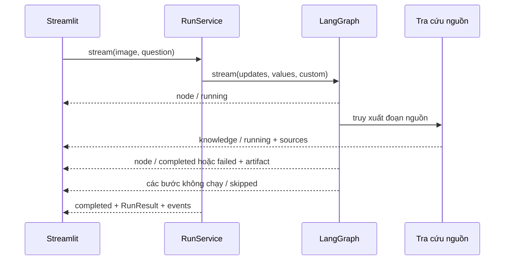

# Giao diện khám phá và theo dõi quá trình

Triển khai trên ứng dụng Streamlit hiện tại, dùng chung RunService với CLI và
chế độ so sánh. Không cần API ngoài cho các thao tác xem lại, lọc nguồn hay xuất
báo cáo. Các lời gọi model vẫn tuân provider/model, ngân sách và retry đã cấu hình.

## Các phần đã triển khai

| Khu vực | Hành vi |
| --- | --- |
| Nhập liệu | Ảnh mẫu có tên dễ đọc, tải JPEG/PNG/WebP, camera, xem trước, xoay 90°, kích thước ảnh và gợi ý khi ảnh nhỏ |
| Câu hỏi | Bốn câu hỏi gợi ý, giới hạn 4.000 ký tự, cách diễn đạt cho khách tham quan/học sinh, câu hỏi tiếp theo dùng cùng ảnh |
| Theo dõi trực tiếp | Thẻ trạng thái cho bảy giai đoạn, sự kiện bắt đầu/kết thúc/lỗi/bỏ qua, thời gian thực; bước vừa cập nhật tự mở khi đang chạy |
| Kết quả trung gian | Kế hoạch tóm tắt, báo cáo quan sát, tư liệu, phân tích bổ sung, bản nháp tùy chọn và nhận xét đánh giá |
| Câu trả lời | Trạng thái đánh giá rõ ràng, định danh sơ bộ có chú thích, trích dẫn chuyển thành liên kết đánh số từ registry nguồn |
| Nguồn | Tất cả nguồn đã truy xuất, lọc theo tên/nội dung và trạng thái trích dẫn, đoạn trích, domain, ID, thời gian truy cập, revision, mở bản gốc |
| Bản đồ | Tìm địa điểm, tìm đường trên Google Maps và tìm tên trên OpenStreetMap; dùng tên nhận diện sơ bộ |
| Chất lượng | Ba tiêu chí của Judge, điều chỉnh, lỗi node, biểu đồ thời gian, model attempts, token thực và mã LangSmith |
| Lịch sử | Tối đa tám lượt trong phiên, ảnh thu nhỏ, đánh dấu và lọc lượt đã đánh dấu, xem lại không gọi model, xóa lịch sử |
| Phản hồi và xuất | Ghi chú/đánh giá cá nhân giữ theo run; JSON/Markdown với nguồn đầy đủ, tùy chọn xuất kết quả trung gian |
| Trình bày | Theme xanh rừng/kem, bố cục co giãn, thẻ có nhãn chữ, giao diện desktop/mobile |

## Luồng sự kiện

`RunEvent` giữ tương thích hai loại `node` và `completed`, bổ sung `run_id`,
`sequence`, `status`, `elapsed`, `duration` và `payload`.

Node phát sự kiện `running` qua custom stream writer của LangGraph. Updates
được chuyển thành projection cho trình bày trong `core/presentation.py`.
Projection gồm kết quả tác vụ, nguồn và metadata chọn lọc. Ảnh, SDK clients,
credential, system prompt và nội dung `plan_reasoning` không nằm trong events.
`RunResult.events` giữ các sự kiện để xem lại và xuất báo cáo.

Knowledge phát nguồn ngay sau truy xuất, trước khi gọi model tổng hợp. Nếu model
gặp lỗi, nguồn đã lấy vẫn nằm trong events, thư viện nguồn và báo cáo tải xuống.
Snapshot hợp nhất nguồn theo `source_id`, giữ dữ liệu khi sự kiện lỗi không có
nguồn mới. Nguồn được trích dẫn và nguồn chỉ được truy xuất có nhãn riêng.

Thanh tiến độ đếm các bước đã kết thúc/bỏ qua, không ước lượng thời gian. Các node
Visual và Knowledge chạy song song nên thời gian node có thể chồng lấp. Bước đánh
giá bị bỏ qua vì thiếu nguồn được giải thích ngay trong artifact.

## Phân biệt nội dung và trạng thái

Báo cáo chuyên gia có nhãn chưa được đánh giá. Công tắc “Xem bản nháp chưa đánh
giá” mặc định tắt; khi bật có chú thích ngay cạnh nội dung. Câu trả lời cuối chỉ
hiện khi trạng thái cho phép công bố. Lỗi Judge không được chuyển thành đạt.

Trích dẫn có liên kết được tạo từ URL của SourceRecord hợp lệ. Judge từ chối
citation trong văn bản dùng mã `wiki_`/`web_` không có trong danh sách trích dẫn.
Nguồn Maps được tách khỏi tài liệu làm bằng chứng.

JSON mặc định giữ nguồn đã truy xuất nhưng loại draft, expert reports và events.
Markdown mặc định gồm câu trả lời được đánh giá, trạng thái, nguồn và thông tin
lượt xử lý. Tùy chọn xuất đầy đủ có nhãn rõ và kèm kết quả trung gian.

## Trạng thái phiên và tối ưu

- Mỗi phiên giữ một ảnh chuẩn hóa theo hash ảnh, góc xoay và giới hạn cấu hình;
  không xử lý lại ảnh khi chỉ lọc nguồn hoặc đổi cách hiển thị.
- Thay ảnh/câu hỏi/audience/mode/cấu hình xóa kết quả hiện tại, giữ lịch sử riêng.
- Lịch sử có ảnh thu nhỏ tối đa 480 × 360; không nhân bản ảnh gốc cho tám lượt.
- Bookmark và feedback dùng store riêng để không mất khi Streamlit dọn widget
  của kết quả không còn hiển thị. Store được giới hạn theo lịch sử.
- Thao tác xem lại, đánh dấu, ghi chú, lọc nguồn và tải file không chạy workflow.
- Tải file dùng `on_click="ignore"`; nguồn/model text không được đưa vào HTML tùy ý.
- LangSmith tiếp tục giữ chính sách che nội dung trong [langsmith.md](langsmith.md).

## Kiểm tra và giới hạn thực tế

Kiểm thử offline gồm event lifecycle, nhánh song song, nguồn đến trước khi model
hoàn tất, giữ nguồn khi model lỗi, trích dẫn, xuất báo cáo, cache/state lịch sử và
Streamlit AppTest. Kiểm tra trình duyệt Edge qua Playwright ở 1440 × 1080 và
390 × 844 dùng nguồn/model giả lập; không gọi API model thật. Xem kết quả kiểm tra
mới nhất trong [implementation-progress.md](implementation-progress.md).

Lịch sử/phản hồi hiện chỉ lưu trong phiên, chưa có đăng nhập hoặc database. Bản
đồ là liên kết tìm kiếm, chưa có tọa độ được xác minh để gắn điểm trong ứng dụng.
Ứng dụng chưa có dữ liệu du lịch thời gian thực về giá vé, giờ mở cửa, tin tức hay
lịch sự kiện. Chi phí và chất lượng model thật cần được đo ở lượt chạy có API.

Tài liệu API tham khảo: [LangGraph streaming](https://docs.langchain.com/oss/python/langgraph/streaming),
[Streamlit camera](https://docs.streamlit.io/develop/api-reference/widgets/st.camera_input),
[Streamlit download](https://docs.streamlit.io/develop/api-reference/widgets/st.download_button).
